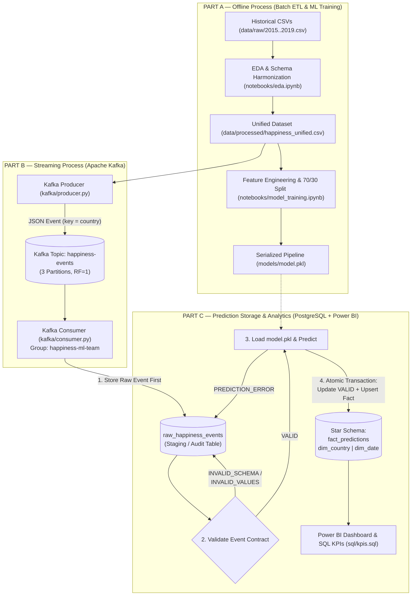
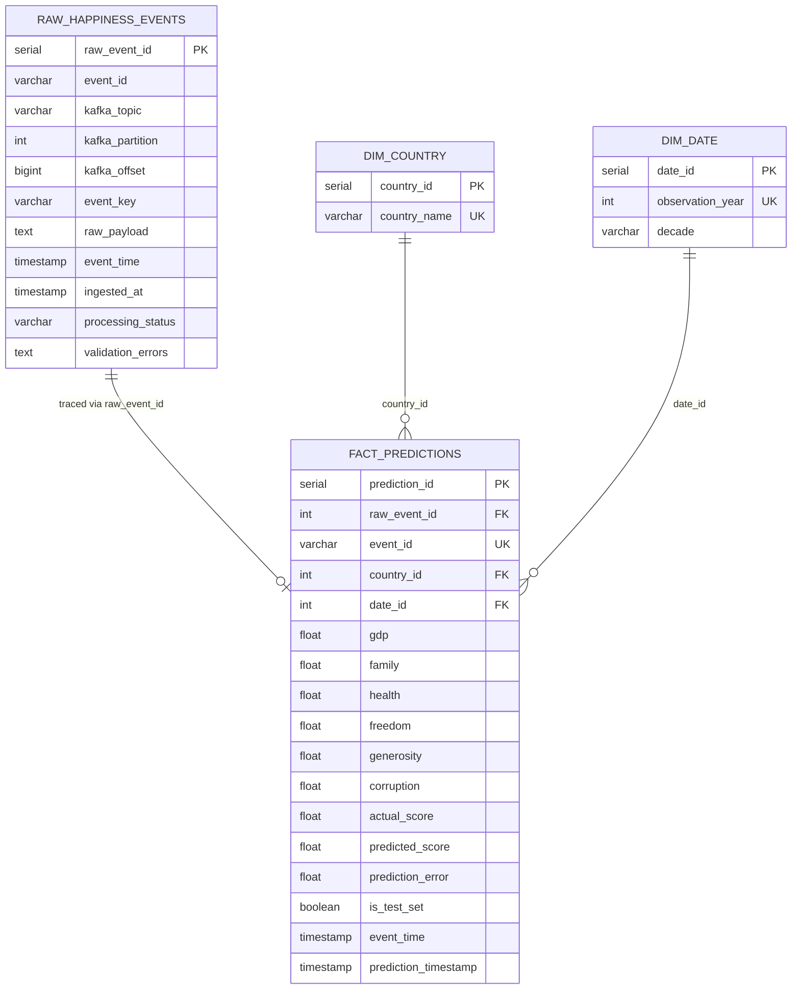

# Workshop-3: Streaming ETL with Apache Kafka and Machine Learning

## 1. Project Description
This project implements an end-to-end **Batch + Streaming ETL and Real-Time Machine Learning Inference Pipeline** using the **World Happiness Report (`2015.csv`–`2019.csv`)** datasets.

The solution transitions from traditional offline batch preparation to an event-driven streaming architecture powered by **Apache Kafka**, **Scikit-learn**, **PostgreSQL**, and **Power BI**:
1. **Part A (Offline Batch Process — Data Profiling & ML)**: Harmonizes 5 heterogeneous historical CSV schemas (`2015`–`2019`) into a unified analytical schema (`782` records), engineers socioeconomic features while preventing target leakage, flags the exact 70%/30% train-test split (`is_test_set`), and trains/serializes a reproducible `scikit-learn` regression pipeline (`models/model.pkl`).
2. **Part B (Streaming ETL Process — Apache Kafka)**: Streams historical records one by one as JSON events through a 3-partition Kafka topic (`happiness-events` keyed by `country`), persists every incoming raw Kafka message into `raw_happiness_events` **before** transformation or prediction, validates each event against a strict **Event Contract**, and runs real-time inference via the consumer group `happiness-ml-team` with manual offset commits and atomic PostgreSQL transactions.
3. **Part C (Prediction Storage & Analytics — PostgreSQL & Power BI)**: Stores validated predictions idempotently in a dimensional Star Schema (`fact_predictions`, `dim_country`, `dim_date`) linked to the raw staging table (`raw_happiness_events`) via `raw_event_id`, and exposes analytical SQL queries (`sql/kpis.sql`) and database views for real-time visualization in **Power BI**.

---

## 2. Architecture Explanation



### Folder Structure
```text
WorkShop-3/
├── data/
│   ├── raw/                        # Original 2015.csv - 2019.csv files
│   ├── processed/                  # Harmonized dataset (happiness_unified.csv)
│   └── streaming/                  # Emitted JSONL event stream snapshot
├── notebooks/
│   ├── eda.ipynb                   # Step 1 & Step 2: EDA, Data Cleaning & Harmonization
│   └── model_training.ipynb        # Step 3 & Step 4: Feature Engineering & ML Training
├── kafka/
│   ├── producer.py                 # Step 5: Kafka Producer (happiness-events, 3 partitions)
│   └── consumer.py                 # Step 6: Kafka Consumer (happiness-ml-team) + Contract Validation
├── models/
│   └── model.pkl                   # Serialized scikit-learn Pipeline (Imputer + Scaler + RF Regressor)
├── sql/
│   ├── create_tables.sql           # Step 7: Raw Table + Star Schema DDL + Power BI Views
│   └── kpis.sql                    # Step 9: Analytical SQL queries for the required KPIs
├── dashboards/                     # Power BI (.pbix) file and screenshots folder
├── docker-compose.yml              # Zookeeper + Apache Kafka + PostgreSQL 15
├── requirements.txt                # Python dependencies
└── README.md                       # Project documentation
```

---

## 3. Data Cleaning & Harmonization Decisions (Part A — Steps 1 & 2)

1. **Schema Harmonization Across 5 Years (`2015`–`2019`)**:
   - The five raw CSV files use different column names (`Economy (GDP per Capita)` in 2015–2016, `Economy..GDP.per.Capita.` in 2017, `GDP per capita` in 2018–2019) and different auxiliary columns.
   - All five datasets were mapped to a single unified schema:
     `country` (`str`), `year` (`int64`), `gdp` (`float64`), `family` (`float64`), `health` (`float64`), `freedom` (`float64`), `generosity` (`float64`), `corruption` (`float64`), `happiness_score` (`float64`), plus `is_test_set` (`bool`).
2. **Handling Missing Values (`2018.csv` — `United Arab Emirates`)**:
   - Across all 782 rows, only **1 missing value** exists: `Perceptions of corruption` is `NaN` for `United Arab Emirates` in `2018.csv` (row 20).
   - **Decision**: Instead of dropping the country's 2018 observation, we imputed the missing value using **United Arab Emirates' historical mean across 2015, 2016, 2017, and 2019 (`0.31198`)**, preserving temporal continuity. Additionally, `SimpleImputer(strategy="median")` is embedded in the `scikit-learn` pipeline as a fallback safeguard.
3. **Standardizing Country Names (Entity Resolution)**:
   - Six territories appeared under inconsistent names across years:
     - `Hong Kong S.A.R., China` (2017) $\rightarrow$ `Hong Kong`
     - `Taiwan Province of China` (2017) $\rightarrow$ `Taiwan`
     - `Trinidad & Tobago` (2018–2019) $\rightarrow$ `Trinidad and Tobago`
     - `Northern Cyprus` (2018–2019) $\rightarrow$ `North Cyprus`
     - `Macedonia` (2015–2018) $\rightarrow$ `North Macedonia`
     - `Somaliland region` (2015) $\rightarrow$ `Somaliland Region`
   - **Decision**: Standardized all 6 names, reducing unique countries from `170` to `164`. This guarantees consistent Kafka partition routing (`key = country`) and prevents duplicate entries in `dim_country`.
4. **Outlier Treatment ($1.5 \times \text{IQR}$ Rule)**:
   - IQR inspection flagged high-end values in `corruption` (67 records, e.g., Denmark, Singapore, New Zealand where government trust is very high), `generosity` (17 records, e.g., Myanmar), and low-end values in `family` (10 records in conflict-affected nations).
   - **Decision**: All 782 records were retained because these represent legitimate socioeconomic extremes rather than measurement corruption.

---

## 4. Feature Engineering & Model Training Decisions (Part A — Steps 3 & 4)

1. **Selected Features (`6` Predictors)**:
   - `['gdp', 'family', 'health', 'freedom', 'generosity', 'corruption']`
   - Pearson correlations with `happiness_score`: `gdp` ($r = 0.789$), `health` ($r = 0.742$), `family` ($r = 0.649$), `freedom` ($r = 0.551$), `corruption` ($r = 0.400$), `generosity` ($r = 0.138$).
2. **Preventing Target Leakage**:
   - Excluded `Dystopia Residual` (only present in 2015–2017, and mathematically defined such that the 6 factors plus `Dystopia Residual` equal `Happiness Score`), `Happiness Rank` / `Overall rank`, `Standard Error`, `Confidence Intervals`, and `Whisker.high/low`.
   - In streaming inference, `actual_happiness_score` is never passed to the model; it is used strictly to compute `prediction_error` after prediction.
3. **Excluding `country` and `year` from Model Inputs**:
   - `country` and `year` are routing/dimensional attributes (`dim_country`, `dim_date`), not socioeconomic predictors. Excluding them allows the model to generalize purely from socioeconomic indicators.
4. **Reproducible `scikit-learn` Pipeline & 70/30 Evaluation**:
   - Data split: **70% training (`547` records)** / **30% testing (`235` records)** (`random_state=42`).
   - Preprocessing (`SimpleImputer(strategy="median")` + `StandardScaler()`) is bundled inside a `sklearn.pipeline.Pipeline` together with the regressor and saved to `models/model.pkl`.

| Model | MAE (Test 30%) | RMSE (Test 30%) | $R^2$ (Test 30%) |
| :--- | :---: | :---: | :---: |
| **Random Forest Regressor (`n_estimators=200`)** *(Saved in `model.pkl`)* | **0.4071** | **0.5213** | **0.7823** |
| Linear Regression | 0.4487 | 0.5846 | 0.7263 |
| Decision Tree Regressor (`max_depth=5`) | 0.5205 | 0.6703 | 0.6401 |

> **Important Note on Streaming Evaluation (`is_test_set`)**:
> Because Part B streams the entire bounded historical dataset (`782` records: `547` training records + `235` test records), the global MAE across all 782 streamed records is `0.2197` (combining the in-sample training MAE of `0.1391` and the out-of-sample test MAE of `0.4071`). To allow complete analytical transparency in PostgreSQL and Power BI, each event and `fact_predictions` row carries `is_test_set` (`TRUE` for the 235 test records, `FALSE` for the 547 training records), and `vw_kpi_summary` / `sql/kpis.sql` report both the global metrics and the strict Test-Set-Only (`30%`) metrics.

---

## 5. Kafka Pipeline, Event Contract & Reliability Guarantees (Part B — Steps 5 & 6)

### Producer (`kafka/producer.py`)
- Automatically creates/verifies topic **`happiness-events`** with **3 partitions** and **replication factor 1**.
- Streams records one by one from `data/processed/happiness_unified.csv` with a configurable delay (`--delay 0.01`), serializing each event as JSON and using **`country` as the Kafka event key** (`key=event["country"].encode("utf-8")`).
- Emits payload in the required format:
```json
{
  "event_id": "E001",
  "country": "Colombia",
  "year": 2019,
  "gdp": 1.2,
  "family": 0.8,
  "health": 0.9,
  "freedom": 0.6,
  "generosity": 0.3,
  "corruption": 0.1,
  "actual_happiness_score": 6.2,
  "event_time": "2026-10-30T15:30:00",
  "is_test_set": true
}
```

### Event Contract, Atomic Persistence & Consumer Reliability (`kafka/consumer.py`)
The consumer (`group.id = happiness-ml-team`) enforces strict data consistency and fault-tolerance guarantees:
1. **Persist Raw Event First (Idempotent by Kafka Offset)**:
   - Every incoming message is immediately inserted into `raw_happiness_events` (`processing_status = 'RECEIVED'`) before parsing, validation, or inference.
   - A `UNIQUE (kafka_topic, kafka_partition, kafka_offset)` constraint ensures that if a consumer restarts or rebalances, re-reading the same offset updates the existing raw record rather than duplicating it.
2. **Contract Validation & Error States**:
   - `INVALID_SCHEMA`: Malformed JSON, missing any of the 11 required contract fields (`event_id`, `country`, `year`, the 6 model features, `actual_happiness_score`, `event_time`), or invalid data types.
   - `INVALID_VALUES`: Empty `event_id` or `country`, `year` outside `[1900, 2100]`, any of the 6 features `NaN`/`Inf` or outside `[0.0, 10.0]`, `actual_happiness_score` outside `(0.0, 10.0]`, or invalid ISO-8601 `event_time`.
   - `PREDICTION_ERROR`: Runtime failure during feature transformation, `model.predict()`, or database persistence (tested via fault injection in `--inject-invalid` with `E_SIM_PRED_ERROR_01`).
   - `VALID`: Passes all checks and proceeds to atomic persistence.
3. **Single Atomic Database Transaction (`commit_valid_prediction_transaction`)**:
   - Updating `raw_happiness_events.processing_status = 'VALID'`, upserting `dim_country` and `dim_date`, and inserting/upserting into `fact_predictions` execute inside a **single PostgreSQL transaction** wrapped in `try/except`. If `fact_predictions` insertion fails for any reason, `conn.rollback()` executes so `raw_happiness_events` is never left inconsistently marked `VALID` without a corresponding prediction row.
4. **Idempotency Across Multiple Producer Runs (`UNIQUE (event_id)`)**:
   - `fact_predictions` enforces `UNIQUE (event_id)` with `ON CONFLICT (event_id) DO UPDATE`, ensuring that running `producer.py` multiple times updates the 782 analytical predictions in place without inflating or duplicating KPI counts.
5. **Manual Kafka Offset Commit (`enable.auto.commit = False`)**:
   - Offsets are committed synchronously (`consumer.commit(message=msg, asynchronous=False)`) **only after** the PostgreSQL transaction has been durably committed, preventing event loss.

---

## 6. Database Schema (Part C — Steps 7 & 8)

Defined in [`sql/create_tables.sql`](sql/create_tables.sql):



---

## 7. Dashboard & KPIs Explanation (Part C — Step 9)

All analytical SQL queries and views for **Power BI** are provided in [`sql/kpis.sql`](sql/kpis.sql) and [`sql/create_tables.sql`](sql/create_tables.sql):

1. **KPI 1 — Average Prediction Error (`vw_kpi_summary`)**:
   - Measures streaming inference accuracy both overall (`mae_all_events = 0.2197`) and strictly on the held-out 30% test split (`mae_test_set_only = 0.4071`, `rmse_test_set_only = 0.5213`).
2. **KPI 2 — Predictions by Country (`vw_predictions_by_country`)**:
   - Compares average `predicted_score`, `actual_score`, and `prediction_error` across all 164 standardized countries (`dim_country`) for geographic map and ranking visuals.
3. **KPI 3 — Predicted vs. Actual Score (`vw_predicted_vs_actual`)**:
   - Event-level scatter and residual analysis comparing `actual_score` against `predicted_score` (`residual_signed = actual_score - predicted_score`), filterable by `dataset_split` (`Test (30%)` vs `Train (70%)`).
4. **KPI 4 — Prediction Trends Over Time (`vw_prediction_trends_over_time`)**:
   - Tracks the evolution of average actual vs. predicted happiness scores and prediction error across historical observation years (`2015`–`2019` via `dim_date`) as well as streaming ingestion timestamps (`prediction_timestamp`).
5. **Audit KPI — Event Contract Status (`vw_event_audit_status`)**:
   - Monitors pipeline reliability by counting `VALID` (`782`), `INVALID_SCHEMA` (`2`), `INVALID_VALUES` (`1`), and `PREDICTION_ERROR` (`1`) records in `raw_happiness_events`.

### Connecting Power BI to PostgreSQL
1. Open **Power BI Desktop** $\rightarrow$ **Get Data** $\rightarrow$ **PostgreSQL database**.
2. Enter Server: `localhost:5432` and Database: `happiness_db` (User: `postgres`, Password: `postgres`).
3. Select the Star Schema tables (`fact_predictions`, `dim_country`, `dim_date`, `raw_happiness_events`) and/or the pre-built analytical views (`vw_kpi_summary`, `vw_predictions_by_country`, `vw_predicted_vs_actual`, `vw_prediction_trends_over_time`, `vw_event_audit_status`).
4. Save the Power BI report (`.pbix`) and screenshots inside the [`dashboards/`](dashboards/) folder.

---

## 8. Execution Instructions

### Step 1: Create & Activate Virtual Environment and Install Dependencies
```powershell
# 1. Create the virtual environment
python -m venv venv

# 2. Activate the virtual environment (Windows PowerShell)
.\venv\Scripts\Activate.ps1

# 3. Install project dependencies
pip install -r requirements.txt
```

### Step 2: Start Kafka, Zookeeper & PostgreSQL via Docker Compose
```powershell
docker compose up -d
```
*(Wait ~15 seconds for Kafka and PostgreSQL healthchecks to pass. PostgreSQL automatically runs `sql/create_tables.sql` on initialization).*

### Step 3: Start the Real-Time Kafka Consumer (Terminal 1)
*(Make sure `.\venv\Scripts\Activate.ps1` is active in Terminal 1)*:
```powershell
python kafka/consumer.py
```

### Step 4: Run the Kafka Producer to Stream Events (Terminal 2)
*(Make sure `.\venv\Scripts\Activate.ps1` is active in Terminal 2)*. Stream all 782 harmonized records (plus 4 test malformed/fault records to verify `INVALID_SCHEMA`, `INVALID_VALUES`, and `PREDICTION_ERROR` handling):
```powershell
python kafka/producer.py --delay 0.01 --inject-invalid
```

### Step 5: Verify Predictions & KPIs in PostgreSQL
Run the analytical KPI queries directly inside the PostgreSQL container:
```powershell
Get-Content sql/kpis.sql | docker exec -i workshop3-postgres psql -U postgres -d happiness_db
```
