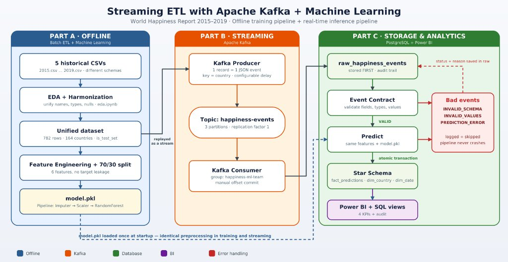
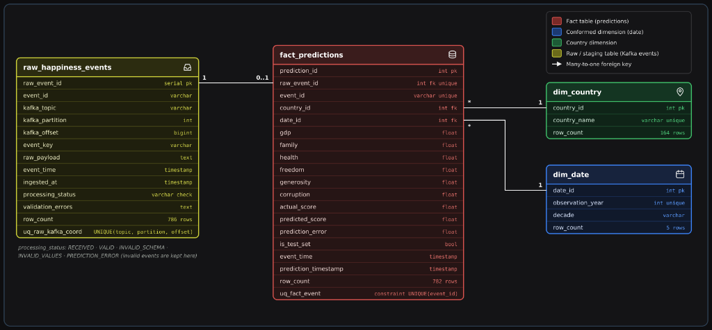

# Workshop-3: Streaming ETL with Apache Kafka and Machine Learning

**Faculty of Engineering and Basic Sciences — Data Engineering and Artificial Intelligence**  
**Course:** ETL (G01)

---

## 1. Project Description

This project designs and implements an end-to-end **Streaming ETL and Real-Time Machine Learning Inference Pipeline** using the **World Happiness Report (`2015.csv`–`2019.csv`)** datasets, **Apache Kafka**, **Scikit-learn**, **PostgreSQL**, and **Power BI**.

### Workshop Goal & Learning Objectives Achieved
The pipeline transitions from traditional batch ETL processing to an event-driven streaming architecture capable of generating and storing real-time predictions with full data lineage and fault tolerance:
1. **Heterogeneous Schema Integration (Part A — Steps 1 & 2)**: Profiles, cleans, and harmonizes 5 yearly CSV files (`2015`–`2019`) with divergent schemas and country naming conventions into a unified analytical dataset (`782` records across `164` countries).
2. **Batch ML Preparation & Serialization (Part A — Steps 3 & 4)**: Selects 6 socioeconomic predictors while preventing target leakage, trains and evaluates three regression algorithms on a **70% training / 30% testing split**, and serializes a reproducible `scikit-learn` `Pipeline` (`SimpleImputer` $\rightarrow$ `StandardScaler` $\rightarrow$ `RandomForestRegressor`) as `models/model.pkl`.
3. **Kafka Event Streaming & Contract Validation (Part B — Steps 5 & 6)**:
   - **Producer (`kafka/producer.py`)**: Replays historical records one by one as JSON events to the `happiness-events` topic (`3` partitions, replication factor `1`) using `country` as the partition key.
   - **Consumer (`kafka/consumer.py`, group `happiness-ml-team`)**: Persists every raw Kafka message into `raw_happiness_events` **before** any transformation or prediction, validates each event against a formal **Event Contract** (`VALID`, `INVALID_SCHEMA`, `INVALID_VALUES`, `PREDICTION_ERROR`), executes real-time inference using `models/model.pkl`, and commits offsets manually after atomic database persistence.
4. **Analytical Star Schema & BI KPIs (Part C — Steps 7, 8 & 9)**: Stores predictions in PostgreSQL using a dimensional model (`fact_predictions`, `dim_country`, `dim_date`) linked to the raw staging table (`raw_happiness_events`) via `raw_event_id`, and exposes analytical views and SQL queries (`sql/kpis.sql`) for **Power BI**.

---

## 2. Architecture Explanation



### 2.1 Offline Process (Part A — Batch ETL & Model Training)
1. **Historical CSV Files (`data/raw/2015.csv`–`2019.csv`)**: Raw yearly reports with differing column names, scales, and auxiliary metrics.
2. **Data Profiling, Cleaning & Schema Harmonization (`notebooks/eda.ipynb`)**: Resolves column naming differences, imputes missing values, standardizes country names, and flags the 70%/30% train-test split (`is_test_set`), producing `data/processed/happiness_unified.csv`.
3. **Feature Engineering & Model Training (`notebooks/model_training.ipynb`)**: Evaluates candidate regression models and exports the complete preprocessing + regression pipeline to `models/model.pkl`.

### 2.2 Streaming Process (Part B & Part C — Real-Time Inference & Analytics)
1. **Kafka Producer (`kafka/producer.py`)**: Reads `happiness_unified.csv` row by row, serializes each observation as a JSON event with an ISO-8601 `event_time`, and publishes it to the **`happiness-events`** topic (`3` partitions, `replication_factor=1`) using `country` as the event key.
2. **Kafka Consumer (`kafka/consumer.py`, group `happiness-ml-team`)**:
   - **Step 1 (Raw Storage First)**: Immediately inserts the original incoming Kafka message into `raw_happiness_events` (`processing_status = 'RECEIVED'`) before parsing or transforming.
   - **Step 2 (Event Contract Validation)**: Checks required fields, data types, domain ranges, and model features. Invalid records are updated in `raw_happiness_events` (`INVALID_SCHEMA` or `INVALID_VALUES`) with their exact error reason and skipped without crashing the pipeline.
   - **Step 3 (Feature Preparation & Real-Time Prediction)**: Orders the 6 features identically to training (`gdp`, `family`, `health`, `freedom`, `generosity`, `corruption`), runs inference via `models/model.pkl`, and computes `prediction_error = |actual_score - predicted_score|`. Runtime inference faults are caught and logged as `PREDICTION_ERROR`.
   - **Step 4 (Atomic Star Schema Persistence & Manual Offset Commit)**: Within a single PostgreSQL transaction, updates `raw_happiness_events` to `VALID`, upserts `dim_country` and `dim_date`, and upserts `fact_predictions` linked via `raw_event_id`. Only after `conn.commit()` succeeds does the consumer manually commit the Kafka offset.
3. **Dashboard & KPIs (`sql/kpis.sql` + Power BI)**: Queries PostgreSQL directly to visualize the 4 core KPIs and contract audit metrics.

---

## 3. Data Cleaning & Harmonization Decisions (Part A — Steps 1 & 2)

Implemented and documented with visual outputs in [`notebooks/eda.ipynb`](notebooks/eda.ipynb):

### 3.1 Schema Differences Across Years (`2015`–`2019`)
The five CSV files do not share a uniform schema:
- **`2015.csv` (`158` rows $\times$ `12` cols) & `2016.csv` (`157` rows $\times$ `13` cols)**: Use spaces and parentheses (`Economy (GDP per Capita)`, `Health (Life Expectancy)`, `Trust (Government Corruption)`) and include `Region`, `Dystopia Residual`, and confidence intervals/standard error.
- **`2017.csv` (`155` rows $\times$ `12` cols)**: Uses dot-separated column names (`Happiness.Score`, `Economy..GDP.per.Capita.`, `Whisker.high`, `Whisker.low`) and removes `Region`.
- **`2018.csv` (`156` rows $\times$ `9` cols) & `2019.csv` (`156` rows $\times$ `9` cols)**: Rename columns (`Score`, `Country or region`, `GDP per capita`, `Social support`, `Healthy life expectancy`, `Freedom to make life choices`, `Perceptions of corruption`) and drop `Dystopia Residual` and confidence intervals.

### 3.2 Unified Analytical Schema Proposal
All 5 datasets were harmonized into the following unified schema (`782` total rows):

| Unified Column | Type | Source Mapping (`2015–2016` / `2017` / `2018–2019`) | Analytical & Streaming Role |
| :--- | :--- | :--- | :--- |
| `country` | `string` | `Country` / `Country` / `Country or region` | Entity name, Kafka event key, `dim_country` business key |
| `year` | `int64` | File year (`2015`–`2019`) | Temporal identifier (`dim_date`) |
| `gdp` | `float64` | `Economy (GDP per Capita)` / `Economy..GDP.per.Capita.` / `GDP per capita` | ML Input Feature 1 |
| `family` | `float64` | `Family` / `Family` / `Social support` | ML Input Feature 2 |
| `health` | `float64` | `Health (Life Expectancy)` / `Health..Life.Expectancy.` / `Healthy life expectancy` | ML Input Feature 3 |
| `freedom` | `float64` | `Freedom` / `Freedom` / `Freedom to make life choices` | ML Input Feature 4 |
| `generosity` | `float64` | `Generosity` / `Generosity` / `Generosity` | ML Input Feature 5 |
| `corruption` | `float64` | `Trust (Government Corruption)` / `Trust..Government.Corruption.` / `Perceptions of corruption` | ML Input Feature 6 |
| `happiness_score` | `float64` | `Happiness Score` / `Happiness.Score` / `Score` | Target variable (`actual_happiness_score`) |
| `is_test_set` | `bool` | Generated via `train_test_split(test_size=0.30, random_state=42)` | Distinguishes `Test (30%)` vs `Train (70%)` in KPIs |

### 3.3 Justification of Cleaning Decisions
1. **Missing Values (`1` null across `782` rows)**:
   - Only `2018.csv` row 20 (`United Arab Emirates`) has a missing value (`Perceptions of corruption = NaN`).
   - **Decision**: Rather than discarding the country's 2018 observation, we imputed the missing value using **United Arab Emirates' historical mean across 2015, 2016, 2017, and 2019 (`0.31198`)**. In addition, `SimpleImputer(strategy="median")` is included as the first step of the serialized `scikit-learn` pipeline.
2. **Duplicated Records**:
   - Verified `0` full-row duplicates and `0` duplicate `(country, year)` pairs across all 5 files.
3. **Entity Resolution (Standardizing Inconsistent Country Names)**:
   - Detected 6 territories whose naming changed across years:
     - `Hong Kong S.A.R., China` (2017) $\rightarrow$ `Hong Kong`
     - `Taiwan Province of China` (2017) $\rightarrow$ `Taiwan`
     - `Trinidad & Tobago` (2018–2019) $\rightarrow$ `Trinidad and Tobago`
     - `Northern Cyprus` (2018–2019) $\rightarrow$ `North Cyprus`
     - `Macedonia` (2015–2018) $\rightarrow$ `North Macedonia`
     - `Somaliland region` (2015) $\rightarrow$ `Somaliland Region`
   - **Decision**: Normalizing these 6 names reduced distinct country entities from `170` to `164`, ensuring all historical events for the same country hash to the same Kafka partition (`key = country`) and map to a single row in `dim_country`.
4. **Outlier Inspection ($1.5 \times \text{IQR}$ Rule)**:
   - `corruption` (`67` upper outliers, e.g., Rwanda, Singapore, Denmark), `generosity` (`17` upper outliers, e.g., Myanmar), and `family` (`10` lower outliers in conflict zones) reflect genuine socioeconomic diversity rather than data corruption. All `782` records were retained.

---

## 4. Feature Engineering & Model Training Decisions (Part A — Steps 3 & 4)

Implemented and documented in [`notebooks/model_training.ipynb`](notebooks/model_training.ipynb):

1. **Feature Selection (`6` Socioeconomic Predictors)**:
   - Selected features: `['gdp', 'family', 'health', 'freedom', 'generosity', 'corruption']`.
   - Pearson correlations with `happiness_score`:
     - `gdp`: **$r = 0.7893$**
     - `health`: **$r = 0.7425$**
     - `family`: **$r = 0.6488$**
     - `freedom`: **$r = 0.5513$**
     - `corruption`: **$r = 0.4000$**
     - `generosity`: **$r = 0.1376$**
2. **Target Leakage Prevention**:
   - **Dropped `Dystopia Residual`**: In the World Happiness Report methodology, the sum of the 6 factors plus `Dystopia Residual` equals `Happiness Score` identically. Keeping it would cause 100% target leakage and fail on 2018–2019 data where it is absent.
   - **Dropped `Happiness Rank` / `Overall rank` & Confidence Intervals / Whiskers**: Direct transformations of the target score.
   - **Strict Isolation of `actual_happiness_score`**: In streaming inference, `actual_happiness_score` is never passed to the model; it is used strictly after prediction to calculate `prediction_error`.
3. **Why `country` and `year` Are Excluded from Model Features**:
   - `country` is the Kafka routing key and `dim_country` foreign key; `year` is the temporal dimension (`dim_date`). Excluding them prevents high-cardinality one-hot encoding and ensures predictions depend solely on socioeconomic indicators.
4. **Reproducible `scikit-learn` Pipeline (`models/model.pkl`)**:
   - Combines `SimpleImputer(strategy="median")` $\rightarrow$ `StandardScaler()` $\rightarrow$ `Regressor` inside a single `sklearn.pipeline.Pipeline` fitted exclusively on the **70% training split (`547` rows)** and evaluated on the **30% test split (`235` rows)** (`random_state=42`):

| Regression Model | MAE (Test 30%) | RMSE (Test 30%) | $R^2$ (Test 30%) |
| :--- | :---: | :---: | :---: |
| **Random Forest Regressor (`n_estimators=200`)** *(Serialized in `model.pkl`)* | **0.4071** | **0.5213** | **0.7823** |
| Linear Regression | 0.4487 | 0.5846 | 0.7263 |
| Decision Tree Regressor (`max_depth=5`) | 0.5205 | 0.6703 | 0.6401 |

> **Streaming Evaluation Note (`is_test_set`)**:
> Because Part B streams all `782` historical records (`547` train + `235` test), the global MAE across all 782 records is `0.2197` (combining in-sample Train MAE `0.1391` and out-of-sample Test MAE `0.4071`). Each record carries `is_test_set` (`True`/`False`) into `fact_predictions` so Power BI and `sql/kpis.sql` can report both the full-stream metrics and the strict held-out **30% Test Set** metrics.

---

## 5. Kafka Pipeline & Event Contract Explanation (Part B — Steps 5 & 6)

### 5.1 Kafka Producer (`kafka/producer.py`)
- Automatically creates/verifies topic **`happiness-events`** with **3 partitions** and **replication factor 1**.
- Reads `data/processed/happiness_unified.csv` record by record, serializes each record as JSON, and publishes to `happiness-events` using **`country` as the Kafka event key** (`key=event["country"].encode("utf-8")`) with a configurable delay (`--delay 0.01`).
- Emits events in the required JSON format:
```json
{
  "event_id": "E001",
  "country": "Colombia",
  "year": 2019,
  "gdp": 1.2,
  "family": 0.8,
  "health": 0.9,
  "freedom": 0.6,
  "generosity": 0.3,
  "corruption": 0.1,
  "actual_happiness_score": 6.2,
  "event_time": "2026-10-30T15:30:00",
  "is_test_set": true
}
```

### 5.2 Event Contract Definition
Before inference, every incoming Kafka message must satisfy the following contract in [`validate_event_contract`](kafka/consumer.py):
- `event_id`: Non-empty string (`str`); unique identifier for traceability.
- `country`: Non-empty string (`str`); also used as the Kafka partition key.
- `year`: Integer (`int`, excluding `bool`) within `[1900, 2100]`.
- `gdp`, `family`, `health`, `freedom`, `generosity`, `corruption`: Finite numeric values (`int` or `float`, excluding `bool`, `NaN`, `Inf`) within `[0.0, 10.0]`. All 6 model features must be present.
- `actual_happiness_score`: Finite numeric value within `(0.0, 10.0]` used **only for post-prediction evaluation**, never as a model input feature.
- `event_time`: Valid ISO-8601 timestamp string representing when the producer emitted the event.

### 5.3 Kafka Consumer & Fault-Tolerance Architecture (`kafka/consumer.py`)
The consumer (`group.id = happiness-ml-team`) implements five reliability guarantees:
1. **Raw Event Storage First**: Every Kafka message is inserted into `raw_happiness_events` (`processing_status = 'RECEIVED'`) **before** validation, feature transformation, or prediction. If the raw insert itself fails due to a database outage, the consumer seeks back to the uncommitted offset (`consumer.seek`) and stops cleanly so zero messages are lost.
2. **All 4 Processing Statuses Tracked & Tested (`--inject-invalid`)**:
   - `VALID` (`782` records): Passes contract validation and succeeds in prediction.
   - `INVALID_SCHEMA` (`2` test records): Malformed JSON, missing required fields/features (`health`, `freedom`), or wrong data types (`gdp = "not_a_number"`).
   - `INVALID_VALUES` (`1` test record): Out-of-bounds numerical values (`gdp = -1.5`, `actual_happiness_score = 99.9`).
   - `PREDICTION_ERROR` (`1` test record): Valid schema/values that encounter a runtime fault during inference (`E_SIM_PRED_ERROR_01`).
   - All invalid/error events are stored in `raw_happiness_events` with their exact `validation_errors` description, skipped from prediction, and **never crash the pipeline**.
3. **Single Atomic Database Transaction**: Updating `raw_happiness_events` to `VALID`, upserting `dim_country` and `dim_date`, and upserting `fact_predictions` occur in one atomic transaction (`commit_valid_prediction_transaction`).
4. **Idempotency Against Re-Runs**: `raw_happiness_events` enforces `UNIQUE (kafka_topic, kafka_partition, kafka_offset)` and `fact_predictions` enforces `UNIQUE (event_id)`, preventing duplicate rows if the producer is executed multiple times.
5. **Manual Offset Commit (`enable.auto.commit = False`)**: Kafka offsets are committed synchronously only after PostgreSQL commits the transaction.

---

## 6. Database Schema (Part C — Steps 7 & 8)

Defined in [`sql/create_tables.sql`](sql/create_tables.sql):



- **Staging / Traceability Table (`raw_happiness_events`)**: Stores the exact raw Kafka payload, partition, offset, status, and validation error reason. Not a dimension table; serves auditing, debugging, and reprocessing.
- **Dimensions (`dim_country`, `dim_date`)**: Normalized lookup tables for country (`164` countries) and observation year (`2015`–`2019`).
- **Fact Table (`fact_predictions`)**: Stores each validated prediction (`actual_score`, `predicted_score`, `prediction_error`), timestamps (`event_time`, `prediction_timestamp`), and foreign keys (`raw_event_id`, `country_id`, `date_id`).

---

## 7. Dashboard & KPIs Explanation (Part C — Step 9)

The dashboard queries **PostgreSQL (`happiness_db`) directly** (never CSV files) using the Star Schema tables and pre-built SQL views in [`sql/create_tables.sql`](sql/create_tables.sql) and [`sql/kpis.sql`](sql/kpis.sql):

1. **KPI 1 — Average Prediction Error (`vw_kpi_summary`)**:
   - Evaluates model accuracy in streaming production: reports `MAE` and `RMSE` both for the **30% Out-of-Sample Test Set (`MAE = 0.4071`, `RMSE = 0.5213`)** and across all `782` events (`MAE = 0.2197`).
2. **KPI 2 — Predictions by Country (`vw_predictions_by_country`)**:
   - Aggregates `avg_actual_score`, `avg_predicted_score`, and `avg_prediction_error` across all `164` countries (`dim_country`) for choropleth maps and Top/Bottom country rankings.
3. **KPI 3 — Predicted vs. Actual Score (`vw_predicted_vs_actual`)**:
   - Event-level comparison (`actual_score`, `predicted_score`, `residual_signed`, `prediction_error`, `dataset_split`) used for scatter plots ($y = \hat{y}$) and residual distribution analysis.
4. **KPI 4 — Prediction Trends Over Time (`vw_prediction_trends_over_time`)**:
   - Tracks average actual vs. predicted happiness scores and prediction error across historical years (`2015`–`2019` via `dim_date`) and real-time streaming ingestion windows (`prediction_timestamp`).
5. **Audit KPI — Event Contract Validation (`vw_event_audit_status`)**:
   - Displays pipeline health and contract enforcement (`782 VALID`, `2 INVALID_SCHEMA`, `1 INVALID_VALUES`, `1 PREDICTION_ERROR`).

### Connecting Power BI Desktop to PostgreSQL
1. Open **Power BI Desktop** $\rightarrow$ **Get Data** $\rightarrow$ **PostgreSQL database**.
2. Server: `localhost:5432` | Database: `happiness_db` | User: `postgres` | Password: `postgres`.
3. Load `fact_predictions`, `dim_country`, `dim_date`, `raw_happiness_events` and/or the views `vw_kpi_summary`, `vw_predictions_by_country`, `vw_predicted_vs_actual`, `vw_prediction_trends_over_time`, `vw_event_audit_status`.
4. Save the Power BI file (`.pbix`) and screenshots in [`dashboards/`](dashboards/).

---

## 8. Repository Folder Structure

```text
WorkShop-3/
├── data/
│   ├── raw/                        # Original historical CSVs (2015.csv - 2019.csv)
│   ├── processed/                  # Harmonized dataset (happiness_unified.csv)
│   └── streaming/                  # Emitted JSONL event stream snapshot
├── notebooks/
│   ├── eda.ipynb                   # Step 1 & Step 2: EDA, Data Cleaning & Harmonization
│   └── model_training.ipynb        # Step 3 & Step 4: Feature Engineering & ML Training
├── kafka/
│   ├── producer.py                 # Step 5: Kafka Producer (happiness-events, 3 partitions)
│   └── consumer.py                 # Step 6: Kafka Consumer (happiness-ml-team) + Contract Validation
├── models/
│   └── model.pkl                   # Serialized scikit-learn Pipeline (Imputer + Scaler + RF Regressor)
├── sql/
│   ├── create_tables.sql           # Step 7: Raw Table + Star Schema DDL + Power BI Views
│   └── kpis.sql                    # Step 9: Analytical SQL queries for the required KPIs
├── dashboards/                     # Power BI (.pbix) file and dashboard screenshots
├── imagenes/
│   ├── architecture.jpg            # End-to-end architecture diagram (Part A, Part B, Part C)
│   └── dimensional_model.png       # Star Schema & Raw Staging Table diagram
├── docker-compose.yml              # Zookeeper + Apache Kafka + PostgreSQL 15
├── requirements.txt                # Python dependencies
└── README.md                       # Mandatory project documentation
```

---

## 9. Execution Instructions

### Step 1: Create & Activate Virtual Environment and Install Dependencies
```powershell
# 1. Create the virtual environment
python -m venv venv

# 2. Activate the virtual environment (Windows PowerShell)
.\venv\Scripts\Activate.ps1

# 3. Install project dependencies
pip install -r requirements.txt
```

### Step 2: Start Kafka, Zookeeper & PostgreSQL via Docker Compose
```powershell
docker compose up -d
```
*(Wait ~15 seconds for containers to be healthy. To apply or reset the database schema cleanly at any time, run)*:
```powershell
Get-Content sql/create_tables.sql | docker exec -i workshop3-postgres psql -U postgres -d happiness_db
```

### Step 3: Start the Real-Time Kafka Consumer (Terminal 1)
*(With `.\venv\Scripts\Activate.ps1` active)*:
```powershell
python kafka/consumer.py
```

### Step 4: Run the Kafka Producer to Stream Events (Terminal 2)
*(With `.\venv\Scripts\Activate.ps1` active)*. Stream all `782` valid historical events plus `4` contract/fault test events (`786` total):
```powershell
python kafka/producer.py --delay 0.01 --inject-invalid
```

### Step 5: Execute Analytical KPI Queries in PostgreSQL
```powershell
Get-Content sql/kpis.sql | docker exec -i workshop3-postgres psql -U postgres -d happiness_db
```

### Step 6: Stop Services (Preserving Database Data)
Press `Ctrl + C` in the consumer terminal, then run:
```powershell
docker compose stop
```
